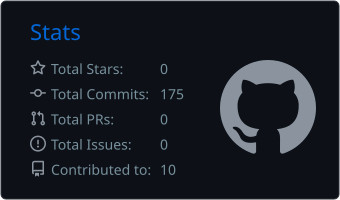
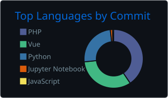

<div align="center">

# 🌿 Oi, eu sou a Isabella!

*Computer Science Student · Developer · Gamer* 🌙

`♡ welcome to my little corner of the internet ♡`

<div align="center">
  
</div>

</div>

### 🍃 Sobre mim

Sou estudante de **Ciência da Computação** e adoro transformar ideias em projetos! Tenho interesse em **desenvolvimento web, banco de dados e inteligência artificial**.

```python
isabella = {
    "curso": "Ciência da Computação",
    "estudando": ["Python", "Vue.js", "IA", "Banco de Dados"],
    "hobbies": ["Jogos", "Programação", "Aprender coisas novas"],
    "mood": "cozy coding 🌙"
}
```

<!-- <div align="center"></div> -->

### Tecnologias que uso

<div align="center">


</div>

### Projetos em destaque

| Projeto | O que é? |
| --- | --- |
| [📚 Equivalência de Ementas — TCC](https://github.com/IsaBarb0sa/equivalencia-ementas-tcc) | Sistema web para apoiar análises de aproveitamento de disciplinas com processamento de linguagem natural e similaridade semântica. |
| [🎸 Riff Run](https://github.com/nelicearaujo/riffrun) | Jogo de plataforma 2D feito com Python e Pygame-CE. |

### Estatísticas do meu GitHub

<div align="center">

<div align="center">

  

  

</div>

</div>

*☕ thanks for stopping by — happy coding! 🌙*

</div>
